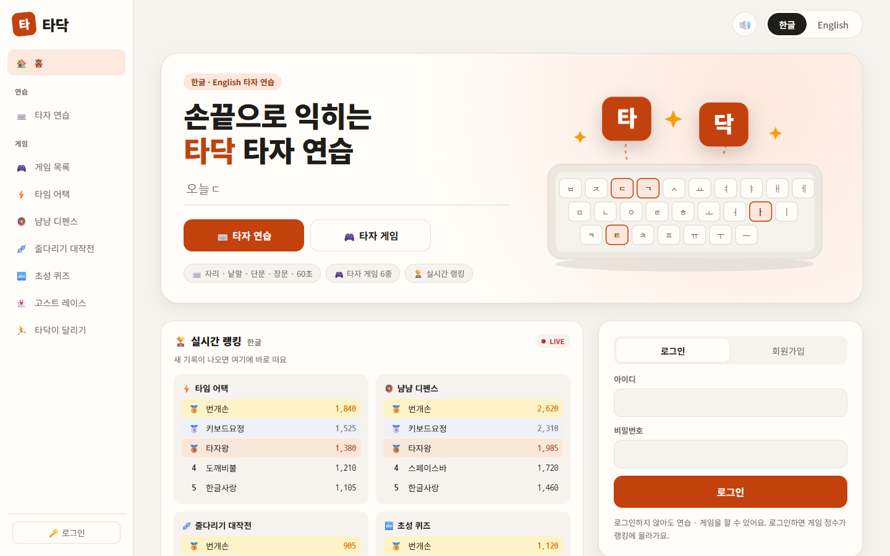
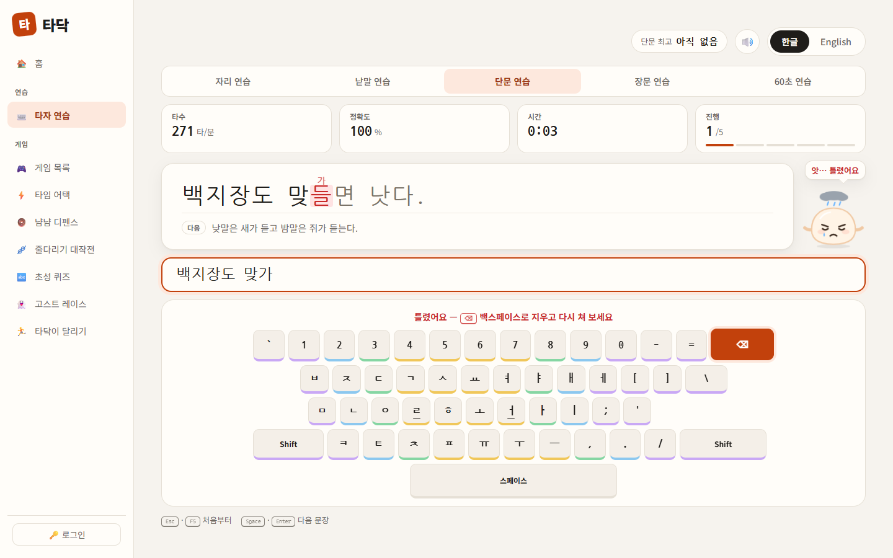
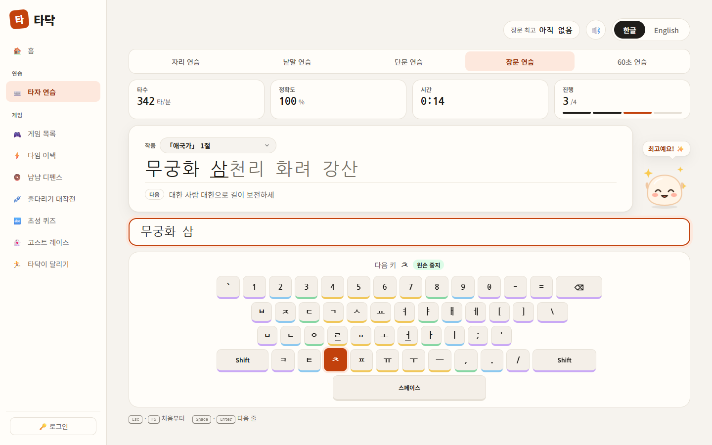
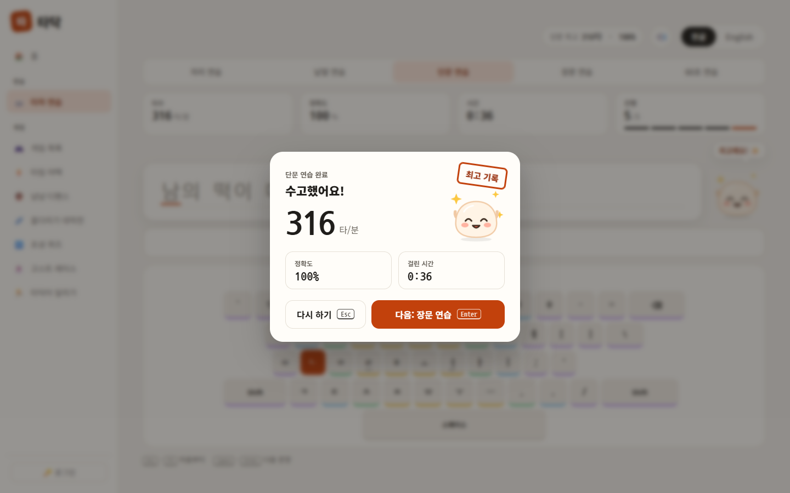
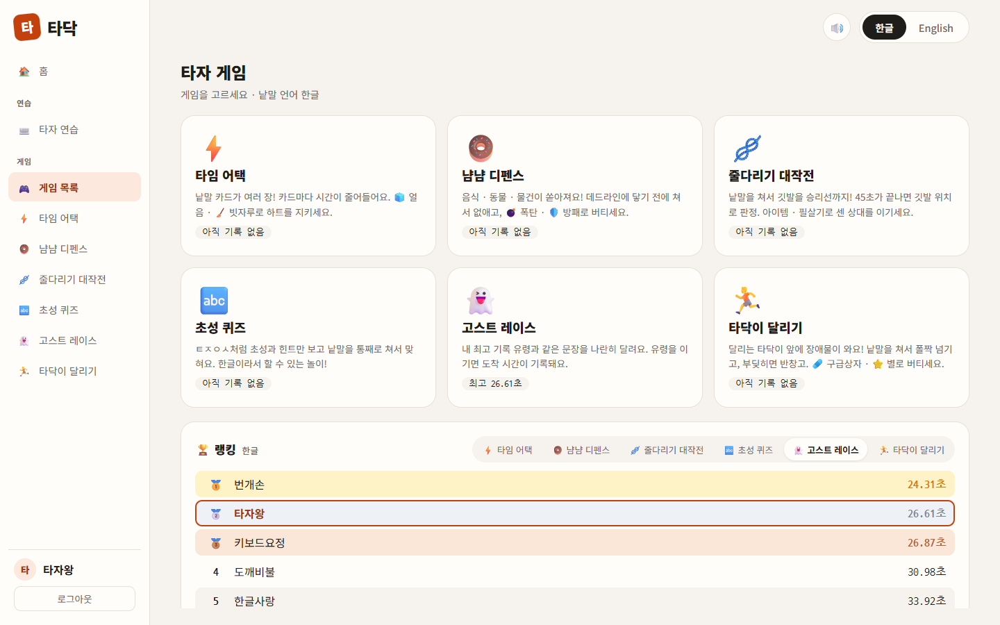
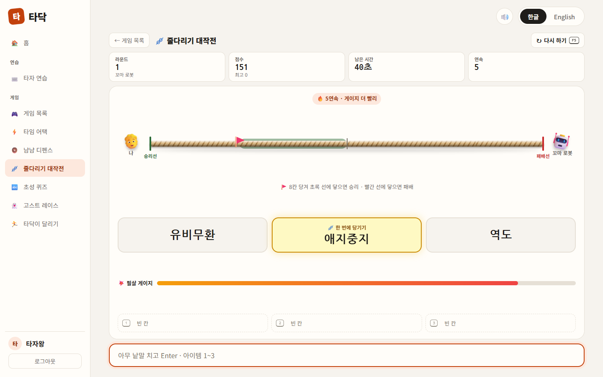
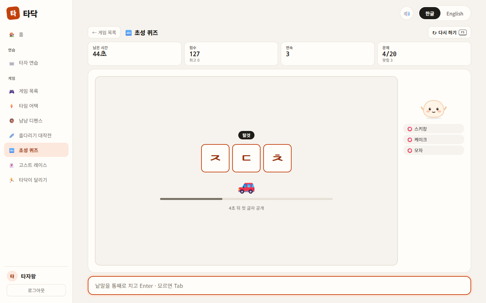
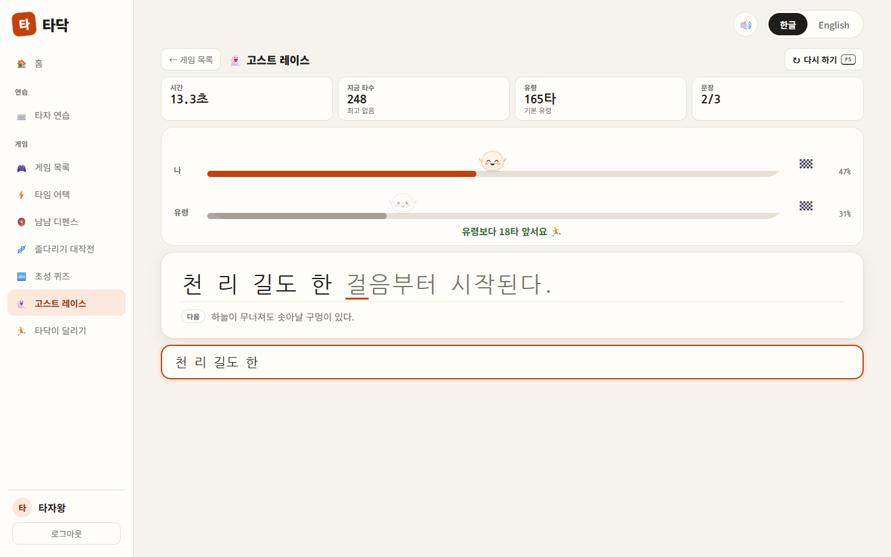
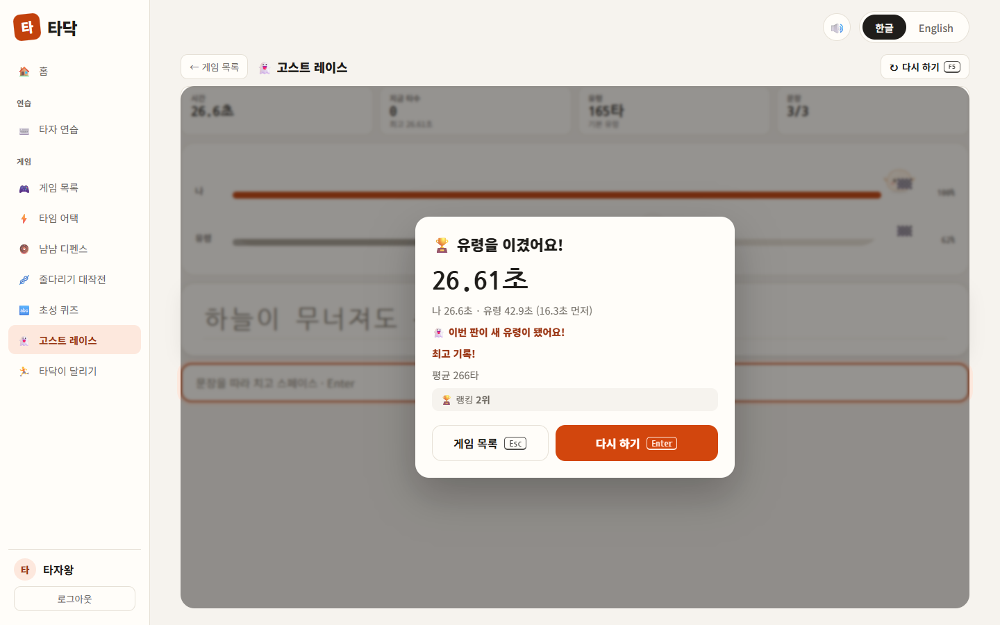

# ⌨️ 타닥 (Tadak)

> React로 만든 한글 · 영어 타자 연습 웹사이트 — 연습 5종 · 타자 게임 6종 · 실시간 랭킹



<br>

## ✨ 주요 기능

- **연습 5종** – 자리 · 낱말 · 단문 · 장문 · 60초 (한컴 타자연습 구성)
- **실시간 정오 판정** – 한글은 조합 중에도 자모 단위로 판정, 틀린 글자 위에 실제로 친 글자를 작게 표시
- **화면 키보드** – 다음에 칠 키와 손가락 안내, 누른 키가 맞으면 초록 · 틀리면 빨강
- **한/영 자동** – 한/영 키를 누르지 않아도 고른 언어로 입력
- **타자 게임 6종** – 한글 · English, 게임 · 언어별 최고 기록
- **로그인 · 랭킹** – 계정별 최고 기록, 게임 랭킹, 새 기록이 바로 뜨는 홈 실시간 랭킹 (로그인 없이도 모든 기능 사용 가능)
- **다크모드 · 효과음 · 좁은 화면 대응**

<br>

## 🖼️ 화면

<table>
  <tr>
    <td width="50%"></td>
    <td width="50%"></td>
  </tr>
  <tr>
    <td><b>단문 연습</b> – 틀린 글자는 빨간색, 그 위에 실제로 친 글자(가)를 표시</td>
    <td><b>장문 연습</b> – 저작권이 끝난 작품 41편, 다음 키와 손가락 안내</td>
  </tr>
  <tr>
    <td></td>
    <td></td>
  </tr>
  <tr>
    <td><b>결과 창</b> – 평균 타수 · 정확도 · 걸린 시간, 최고 기록 도장</td>
    <td><b>게임 목록 · 랭킹</b> – 게임 · 언어별 상위 10명, 내 줄 강조</td>
  </tr>
  <tr>
    <td></td>
    <td></td>
  </tr>
  <tr>
    <td><b>줄다리기 대작전</b> – 낱말을 쳐서 밧줄을 한 칸씩 당기는 로봇과의 대결</td>
    <td><b>초성 퀴즈</b> – 초성과 그림 힌트만 보고 낱말 맞히기</td>
  </tr>
  <tr>
    <td></td>
    <td></td>
  </tr>
  <tr>
    <td><b>고스트 레이스</b> – 내 최고 기록 유령과 같은 문장을 나란히 달리기</td>
    <td><b>게임 결과</b> – 기록을 랭킹에 올리고 내 순위를 바로 표시</td>
  </tr>
</table>

<br>

## 🎮 타자 게임 6종

| 게임 | 규칙 |
| --- | --- |
| ⚡ 타임 어택 | 카드마다 줄어드는 시간 안에 낱말 치기. 놓치면 하트 하나 |
| 🍩 냠냠 디펜스 | 떨어지는 낱말을 데드라인에 닿기 전에 쳐서 없애기 |
| 🪢 줄다리기 대작전 | 한 낱말에 한 칸, 8칸 끝까지 당기면 라운드 승리. 라운드마다 더 센 상대 |
| 🔤 초성 퀴즈 | 50초 안에 20문제. 다 풀어야 랭킹에 기록 (한글 전용) |
| 👻 고스트 레이스 | 같은 문장 3개를 유령과 경주. 이기면 도착 시간이 기록 (짧을수록 위) |
| 🏃 타닥이 달리기 | 장애물 위 낱말을 쳐서 넘기. 부딪히면 반창고, 5개면 끝 |

<br>

## 🧰 기술 스택

| 구분 | 사용 기술 |
| --- | --- |
| Framework | React |
| Build Tool | Vite |
| Language | JavaScript |
| Styling | CSS |
| Storage | localStorage (최고 기록 · 설정) |
| Backend | Supabase (로그인 · 랭킹 · Realtime) |

<br>

## 🚀 실행 방법

```bash
git clone https://github.com/gaeuns/react-typing-game.git
cd react-typing-game
npm install
npm run dev   # http://localhost:5173
```

### 로그인 · 랭킹 (선택)

Supabase가 없어도 연습 · 게임은 모두 동작합니다. 로그인과 랭킹을 쓰려면:

1. Supabase 프로젝트에 `supabase/migrations/`의 SQL을 적용
   - 로그인은 Auth 이메일 칸에 `아이디@tadak.invalid`를 쓰므로 Authentication → Email의 **Confirm email**은 끄기
2. `.env.example`을 `.env.local`로 복사해 프로젝트 주소와 공개(publishable) 키를 채우고 개발 서버 재시작

<br>

## 💡 구현 포인트

- **조합 중인 한글도 바로 판정** – 한글을 두벌식 키 입력 순서로 펼쳐(`과` → `ㄱ ㅗ ㅏ`) 조합 중인 글자가 목표의 앞부분인지 비교. `가나`를 칠 때 잠깐 `간`이 되는 도깨비불 현상 때문에 다음 글자까지 이어서 비교하고, 같은 방법으로 다음에 칠 키를 계산 (`utils/hangul.js`)
- **한글 타수 = 실제 키 입력 수** – `가` = 2타, `왔` = 4타(ㅇ+ㅗ+ㅏ+ㅆ)처럼 초성 · 중성 · 종성으로 분해해서 계산 (`utils/calculate.js`의 `countStrokes`)
- **한/영 자동** – 키보드의 물리 키 코드(`KeyboardEvent.code`)를 앱이 직접 글자로 바꾸고 한글은 직접 조합해서, 입력기 상태와 상관없이 같은 자리는 같은 글자 (`utils/hangulInput.js`)
- **조합 중에 누른 Enter** – 마지막 글자 조합 중 Enter를 누르면 글자가 `compositionend`에서야 확정되므로, 눌린 Enter · 스페이스를 기억해 뒀다가 조합이 끝나는 순간 제출 (`games/useGameInput.js`)

<br>

<details>
<summary><b>📁 폴더 구조</b></summary>

```
src/
├── components/   # 공통 화면 조각 — 문장 판정 표시, 화면 키보드, 결과 창, 메뉴, 로그인 카드, 랭킹
├── views/        # 화면 — 메인(HomeView) · 타자 연습(PracticeView) · 게임(GameView)
├── games/        # 게임 6종 + 공통(게임 루프 · 입력 훅 · 시작/결과 창 · 랭킹 한 줄)
├── data/         # 문장 · 장문 작품 · 낱말 · 자판 배열 · 게임 목록
├── hooks/        # 타이머 · 로그인 상태
├── utils/        # 한글 분해 · 한/영 자동 · 타수 계산 · 저장 · Supabase · 효과음
├── App.jsx
└── main.jsx
supabase/migrations/  # 테이블 · 랭킹 함수 · RLS
```

</details>
